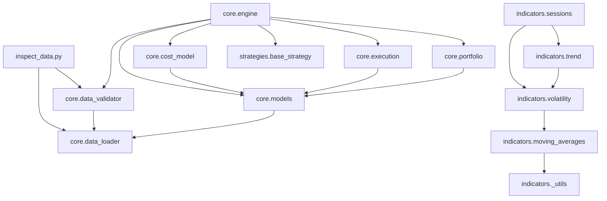

# Tổng quan hồ sơ kiểm toán Quant Backtest System

Thời điểm thu thập UTC: 2026-11-17T09:33:31.742505+00:00. Commit nền: `7af3b774b1721e091e2527a00563912255d44702`.
Snapshot là toàn bộ file hiện tại trong working tree, gồm thay đổi chưa commit và file untracked, không phải bản xuất riêng commit.
Phạm vi khảo sát: 54 file văn bản liên quan, trong đó 39 file Python.
Mục tiêu dự án: nghiên cứu, mô phỏng và đánh giá Forex lịch sử; kết quả mô phỏng là giả định.

## Kiến trúc quan sát từ mã



Đồ thị trên thể hiện các cạnh chính. Danh sách import đầy đủ và API từng module nằm ở `00A_SOURCE_INVENTORY.md`.
Engine triển khai mô phỏng một công cụ, tối đa một vị thế, market BUY/SELL/EXIT ở nến có dữ liệu kế tiếp;
SL/TP trên phía giá thực thi, SL trước khi cả hai cùng chạm, gap stop dùng open và gap TP dùng target.
Chi phí tập trung trong CostModel; spread/slippage nằm trong giá fill, commission thu mỗi phía.
Portfolio dùng tài sản bảo đảm toàn notional, không leverage, quy đổi quote/account bằng tỷ giá đã công bố.
State cuối nến đánh dấu vị thế còn mở; không cưỡng bức đóng cuối mẫu.

## Trạng thái thực tế

- Có implementation loader/validator, indicators, engine/execution/costs/portfolio/models và kiểm tra nhân quả theo prefix.
- `core/data_manager.py`, `core/metrics.py`, `indicators/custom_indicators.py`, `strategies/first_strategy.py` chỉ có docstring/import.
- `core/__init__.py`, `strategies/__init__.py` rỗng; đây là file khởi tạo package, không tự coi là lỗi.
- `BaseStrategy.generate_signals` cố ý raise NotImplementedError để lớp con định nghĩa.
- `run_backtest.py` chỉ in thông báo; chưa nối cấu hình, simulation và xuất research report.
- Không tồn tại `validation/`, walk-forward, sensitivity hay chiến lược nghiên cứu hoàn chỉnh trong `strategies/`.
- README còn mô tả giai đoạn đầu; phiên bản và kết quả test hiện tại lấy từ lần chạy mới bên dưới.

## Quy tắc gap được chấp nhận cho cuộc kiểm toán này

Chỉ yêu cầu cảnh báo khoảng thiếu nến giữa hai timestamp liên tiếp cùng ngày UTC.
Khoảng qua ngày UTC, cuối tuần và lễ được bỏ qua trong chế độ mặc định. Không yêu cầu lịch Forex đầy đủ;
không xếp thiếu lịch đó là lỗi nghiêm trọng. Timestamp trùng, sai thứ tự, NaN/Infinity, giá không hợp lệ và OHLC sai vẫn phải bị phát hiện.
`expected_timestamps` là chế độ lịch độc lập tùy chọn, chặt hơn yêu cầu mặc định.
Quy tắc này là chỉ thị cụ thể của người yêu cầu, ưu tiên khi đọc các quy tắc tổng quát gốc ở `00B_PROJECT_RULES.md`.

## Môi trường và kiểm chứng

Python: `3.15.2 (tags/v3.15.2:5e58eaa, Oct 25 2026, 17:27:03) [MSC v.1951 64 bit (AMD64)]`. Interpreter: `C:\Users\Admin\Documents\quant_backtest_system\.venv\Scripts\python.exe`.
Pytest: 296 passed, 0 failed, 0 errors, 0 skipped.
39 file Python biên dịch trong bộ nhớ thành công. Coverage và các static analyzer phổ biến không có sẵn.
Chi tiết, lệnh thực tế, stdout/stderr nguyên vẹn: `07_TEST_RESULTS.md`.
Không chạy các CLI xử lý dữ liệu thật hoặc benchmark dài. Báo cáo cũ trong reports/runs không được dùng làm bằng chứng thực thi mới.

## Thư viện hiện có

| Distribution | Version |
|---|---|
| PyYAML | 6.0.3 |
| Pygments | 2.21.0 |
| colorama | 0.4.6 |
| iniconfig | 2.3.1 |
| numpy | 2.5.5 |
| packaging | 26.3 |
| pandas | 3.1.1 |
| pip | 26.2.2 |
| pluggy | 1.7.0 |
| pyarrow | 26.0.1 |
| pytest | 9.2.0 |
| python-dateutil | 4.0.0 |
| quant-backtest-system | 0.1.0 |
| tzdata | 2026.6 |


## Trạng thái Git trước kiểm tra

```text
 M README.md
 M core/cost_model.py
 M core/engine.py
 M indicators/__init__.py
 M pyproject.toml
 M strategies/base_strategy.py
?? benchmark_engine.py
?? configs/data_pipeline.yaml
?? core/BACKTEST_ENGINE.md
?? core/causality.py
?? core/data_loader.py
?? core/data_validator.py
?? core/execution.py
?? core/models.py
?? core/portfolio.py
?? data/metadata/datasets.json
?? data/metadata/metadata_template.yaml
?? indicators/INDICATORS.md
?? indicators/_utils.py
?? indicators/market_structure.py
?? indicators/momentum.py
?? indicators/moving_averages.py
?? indicators/price_action.py
?? indicators/sessions.py
?? indicators/trend.py
?? indicators/volatility.py
?? inspect_data.py
?? inspect_indicators.py
?? reports/external_audit/audit_evidence.py
?? tests/test_backtest_models.py
?? tests/test_cost_model.py
?? tests/test_data_loader.py
?? tests/test_data_validator.py
?? tests/test_engine.py
?? tests/test_execution.py
?? tests/test_indicators.py
?? tests/test_intraday_gaps.py
?? tests/test_portfolio.py
?? tests/test_stage4_review.py
```

## Tài liệu và entry point gốc

## File gốc: `README.md`

Đường dẫn tuyệt đối: `C:\Users\Admin\Documents\quant_backtest_system\README.md`

Số dòng: 116; kích thước: 5310 bytes; SHA256: `9c4081319675161b9283a6d61e08a4e92711c6818bd5c050112b22e68d6677f8`.

<!-- SOURCE_BEGIN README.md -->
````markdown
# Quant Backtest System

Hệ thống nghiên cứu và mô phỏng chiến lược trên dữ liệu Forex lịch sử.
Kết quả mô phỏng mang tính giả định và không bảo đảm lợi nhuận tương lai.

Giai đoạn 1 thiết lập môi trường Python, quản lý phụ thuộc và kiểm tra môi trường.
Giai đoạn 4 bổ sung engine mô phỏng một công cụ với lệnh thị trường ở nến kế tiếp,
SL/TP, chi phí và sổ tài khoản. Xem [quy ước engine](core/BACKTEST_ENGINE.md) để
biết giao diện API, công thức tính tay và các giới hạn hỗ trợ.

## Yêu cầu

- Python 3.11 trở lên và môi trường ảo riêng `.venv`.
- Thực hiện các lệnh PowerShell bên dưới tại thư mục gốc dự án.
- Cần kết nối kho gói Python khi cài thư viện lần đầu.

## Chuẩn bị môi trường

Kiểm tra Python và môi trường hiện có:

```powershell
python --version
Test-Path .\.venv\Scripts\python.exe
```

Chỉ tạo môi trường nếu chưa có `.venv`:

```powershell
python -m venv .venv
```

Nếu `.venv` đã tồn tại, kiểm tra trước khi sử dụng; không tạo đè hoặc xóa môi trường cũ:

```powershell
.\.venv\Scripts\python.exe -c "import sys; print(sys.version); print(sys.executable); print(sys.prefix != sys.base_prefix)"
```

Cài dự án ở chế độ chỉnh sửa cùng công cụ kiểm thử:

```powershell
.\.venv\Scripts\python.exe -m pip install --only-binary=:all: -e ".[dev]"
```

Chế độ chỉnh sửa giúp thay đổi mã nguồn được nhận ngay trong môi trường.
Tùy chọn `--only-binary=:all:` yêu cầu các phụ thuộc có gói dựng sẵn,
tránh biên dịch NumPy hoặc pandas trên máy. Nếu không có gói tương thích,
hãy kiểm tra hỗ trợ phiên bản Python trước khi thay đổi môi trường.
Không cần kích hoạt `.venv` khi gọi trực tiếp trình thông dịch như trên.

Trong lần thiết lập trên máy này, lệnh chỉ dùng gói dựng sẵn không tìm thấy
PyYAML phù hợp. Lệnh sau đã cài thành công bằng cách cho phép riêng PyYAML
sử dụng mã nguồn hoặc gói trong bộ nhớ đệm:

```powershell
.\.venv\Scripts\python.exe -m pip install --only-binary=:all: --no-binary=PyYAML -e ".[dev]"
```

Môi trường đã kiểm tra: Python 3.15.2, NumPy 2.5.5, pandas 3.1.1,
PyYAML 6.0.3 và pytest 9.2.0. Kiểm tra import thành công,
`pip check` không phát hiện phụ thuộc lỗi và pytest có 1 bài test đạt.

## Thư viện ban đầu

| Thư viện | Mục đích |
| --- | --- |
| NumPy | Xử lý mảng và tính toán số |
| pandas | Dữ liệu dạng bảng và chuỗi thời gian |
| PyYAML | Đọc cấu hình YAML bằng `safe_load` |
| pytest | Chạy kiểm thử, thuộc nhóm phụ thuộc `dev` |

Phụ thuộc được khai báo tập trung trong `pyproject.toml`, với giới hạn phiên bản
chính để giảm nâng cấp ngoài dự kiến. Chưa cần SciPy, matplotlib, pyarrow hay
framework backtest trong giai đoạn này.

## Kiểm tra

```powershell
.\.venv\Scripts\python.exe -c "import numpy, pandas, yaml, pytest; print(numpy.__version__, pandas.__version__, yaml.__version__, pytest.__version__)"
.\.venv\Scripts\python.exe -m pip check
.\.venv\Scripts\python.exe -m pytest
```

Bài test `tests/test_environment.py` kiểm tra môi trường ảo, khả năng phối hợp
NumPy/pandas/PyYAML, phép tính đơn giản và chỉ mục thời gian UTC.
Đây là kiểm tra môi trường, chưa xác nhận tính đúng đắn của thuật toán backtest.
Cấu hình pytest nằm trong `pyproject.toml`; không cần `pytest.ini` riêng.

Để ghi nhận phiên bản đang cài:

```powershell
.\.venv\Scripts\python.exe -m pip list
```

Các khoảng phiên bản trong `pyproject.toml` chưa phải tệp khóa phụ thuộc.
Cài đặt ở thời điểm khác có thể chọn phiên bản khác; cần khóa phiên bản và
ghi nhận môi trường trước khi thực hiện các nghiên cứu cần tái lập chính xác.

## Sử dụng trong VS Code

Mở Command Palette bằng `Ctrl+Shift+P`, chọn **Python: Select Interpreter**,
rồi chọn `.venv\Scripts\python.exe` của dự án. Để chạy test trong giao diện,
chọn **Python: Configure Tests**, chọn **pytest** và thư mục **tests**.
Cấu hình VS Code có sẵn được giữ nguyên.

## Cấu trúc và nguyên tắc

- `.clinerules/`: bốn file quy tắc của dự án.
- `configs/`: cấu hình nghiên cứu.
- `core/`, `indicators/`, `strategies/`: các file khung hiện có.
- `data/raw/`, `data/processed/`, `data/metadata/`: dữ liệu và thông tin nguồn.
- `reports/runs/`: kết quả nghiên cứu theo từng lần chạy.
- `tests/`: kiểm thử tự động.

Dữ liệu gốc và báo cáo cũ phải được bảo toàn. Thời gian nội bộ sử dụng UTC
có múi giờ. Các bước sau cần kiểm tra dữ liệu và ngăn việc dùng thông tin tương lai
trước khi triển khai mô phỏng. Dự án chỉ phục vụ nghiên cứu lịch sử.
````
<!-- SOURCE_END README.md -->

## File gốc: `pyproject.toml`

Đường dẫn tuyệt đối: `C:\Users\Admin\Documents\quant_backtest_system\pyproject.toml`

Số dòng: 29; kích thước: 726 bytes; SHA256: `8cc6c6a19958d3254d69361dccd1fdc92ae470f259e1ff88fe3a4f88235cb892`.

<!-- SOURCE_BEGIN pyproject.toml -->
```toml
[build-system]
requires = ["setuptools>=68"]
build-backend = "setuptools.build_meta"

[project]
name = "quant-backtest-system"
version = "0.1.0"
description = "Reproducible historical Forex research environment"
readme = "README.md"
requires-python = ">=3.11"
dependencies = [
    "numpy>=1.26,<3",
    "pandas>=2.2,<4",
    "PyYAML>=6.0.1,<7",
    "pyarrow>=23,<40",
]

[project.optional-dependencies]
dev = ["pytest>=8,<10"]

[tool.setuptools.packages.find]
where = ["."]
include = ["core", "core.*", "indicators", "indicators.*", "strategies", "strategies.*"]
namespaces = false

[tool.pytest.ini_options]
minversion = "8.0"
testpaths = ["tests"]
addopts = "-ra --strict-config --strict-markers"
```
<!-- SOURCE_END pyproject.toml -->

## File gốc: `run_backtest.py`

Đường dẫn tuyệt đối: `C:\Users\Admin\Documents\quant_backtest_system\run_backtest.py`

Số dòng: 9; kích thước: 288 bytes; SHA256: `42967f49c9b2640f54332b14bdee8232711a1117218e81023bd17425434a3f28`.

<!-- SOURCE_BEGIN run_backtest.py -->
```python
"""Điểm khởi chạy chính của hệ thống Quant Backtest."""
from pathlib import Path

def main():
    print("🚀 Hệ thống Quant Backtest MVP đã sẵn sàng!")
    print(f"Thư mục làm việc hiện tại: {Path.cwd()}")

if __name__ == "__main__":
    main()
```
<!-- SOURCE_END run_backtest.py -->

## File gốc: `.gitignore`

Đường dẫn tuyệt đối: `C:\Users\Admin\Documents\quant_backtest_system\.gitignore`

Số dòng: 37; kích thước: 579 bytes; SHA256: `be0d2f36340d702fbc07a7480d90153cf4d8c90953753674dec5e1799759b325`.

<!-- SOURCE_BEGIN .gitignore -->
```text
# Môi trường ảo & Cache Python
.venv/
venv/
__pycache__/
*.py[cod]
.ipynb_checkpoints/

# Dữ liệu nặng & Kết quả chạy (Không đẩy lên Git)
data/raw/*
data/processed/*
reports/runs/*
!data/raw/.gitkeep
!data/processed/.gitkeep
!reports/runs/.gitkeep

# Biến môi trường nhạy cảm
.env

# Test, build, and tool caches
.pytest_cache/
.coverage
htmlcov/
build/
dist/
*.egg-info/
.ruff_cache/
.mypy_cache/
.dukascopy-cache/
/download/

# Local secrets and temporary files
.env.*
!.env.example
*.pem
*.key
*.log
*.tmp
```
<!-- SOURCE_END .gitignore -->

## File gốc: `.vscode/settings.json`

Đường dẫn tuyệt đối: `C:\Users\Admin\Documents\quant_backtest_system\.vscode\settings.json`

Số dòng: 3; kích thước: 68 bytes; SHA256: `b3f38d5469db454a51c0c705ae9160a4e133df1f23c19f7086cce7169a544aa9`.

<!-- SOURCE_BEGIN .vscode/settings.json -->
```json
{
    "python-envs.defaultEnvManager": "ms-python.python:system"
}
```
<!-- SOURCE_END .vscode/settings.json -->
